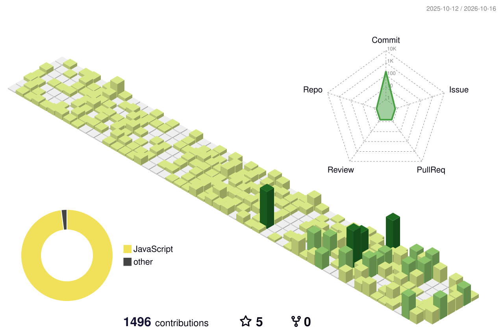

<table>
<tr>
<td width="45%" valign="top">
<picture>
  <source media="(prefers-color-scheme: dark)" srcset="./portrait-dark.svg">
  <source media="(prefers-color-scheme: light)" srcset="./portrait-light.svg">
  
</picture>
</td>
<td width="55%" valign="top">

```yaml
ayush@github ~ $ neofetch
-------------------------
Name:      Ayush Mishra
Handle:    IMshadow8802
Role:      Full-stack developer
Location:  Delhi, India
Web:       Next.js · React · Vite
Mobile:    iOS & Android · React Native · Expo
Backend:   Node.js · Express · REST APIs
Data:      SQL Server · Postgres · MySQL · MongoDB
Payments:  Gateway integrations
Infra:     Linux servers · Domains · Deploys
Business:  ERP · POS · Inventory systems
Uptime:    shipping production apps
```

<a href="https://ayush.shadowcodes.in"></a>
<a href="https://instagram.com/ayush_m.ishra"></a>

</td>
</tr>
</table>

### What I build

- **Mobile apps for iOS and Android** with React Native and Expo, from first screen to App Store and Play Store
- **Web apps** with Next.js, React and Vite
- **APIs and backends** in Node.js and Express, including payment gateway integrations
- **Databases** of every flavour: SQL Server stored procedures and reporting, Postgres, MySQL, MongoDB
- **Servers and deployment**: Linux server management, domains and DNS, hosting and releases
- **Business software** for manufacturing, jewellery, education and retail: ERP, POS and inventory systems

### Tech stack

<table>
<tr><td><b>Web</b></td><td></td></tr>
<tr><td><b>Mobile</b></td><td> &nbsp;React Native · Expo</td></tr>
<tr><td><b>Backend</b></td><td> &nbsp;REST APIs · Payments</td></tr>
<tr><td><b>Databases</b></td><td> &nbsp;SQL Server</td></tr>
<tr><td><b>Servers & cloud</b></td><td></td></tr>
<tr><td><b>Desktop</b></td><td> &nbsp;WinForms</td></tr>
</table>

### Contributions

<picture>
  <source media="(prefers-color-scheme: dark)" srcset="./profile-3d-contrib/profile-night-rainbow.svg">
  <source media="(prefers-color-scheme: light)" srcset="./profile-3d-contrib/profile-green-animate.svg">
  
</picture>

<picture>
  <source media="(prefers-color-scheme: dark)" srcset="https://raw.githubusercontent.com/IMshadow8802/IMshadow8802/output/commit-invaders-dark.svg">
  <source media="(prefers-color-scheme: light)" srcset="https://raw.githubusercontent.com/IMshadow8802/IMshadow8802/output/commit-invaders.svg">
  
</picture>
