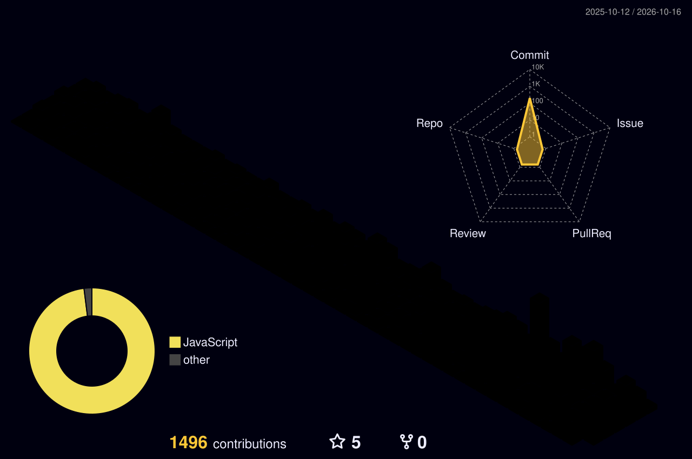

<picture>
  <source media="(prefers-color-scheme: dark)" srcset="./hero-dark.svg">
  <source media="(prefers-color-scheme: light)" srcset="./hero-light.svg">
  
</picture>

### What I build

- **Mobile apps** for iOS and Android with  , from first screen to App Store and Play Store
- **Web apps** with   
- **Desktop apps** with  
- **APIs and backends** in  , including payment gateway integrations
- **Databases** of every flavour:    
- **Servers and deployment**:   servers, domains and DNS, hosting and releases
- **Business software** for manufacturing, jewellery, education and retail: ERP, POS and inventory systems

### Tech stack

<table>
<tr><td><b>Web</b></td><td></td></tr>
<tr><td><b>Mobile</b></td><td> </td></tr>
<tr><td><b>Desktop</b></td><td></td></tr>
<tr><td><b>Backend</b></td><td></td></tr>
<tr><td><b>Databases</b></td><td> </td></tr>
<tr><td><b>Servers & cloud</b></td><td></td></tr>
</table>

### Contributions

<picture>
  <source media="(prefers-color-scheme: dark)" srcset="https://raw.githubusercontent.com/IMshadow8802/IMshadow8802/output/commit-invaders-dark.svg">
  <source media="(prefers-color-scheme: light)" srcset="https://raw.githubusercontent.com/IMshadow8802/IMshadow8802/output/commit-invaders.svg">
  
</picture>
